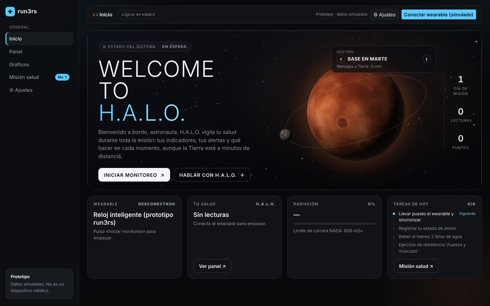
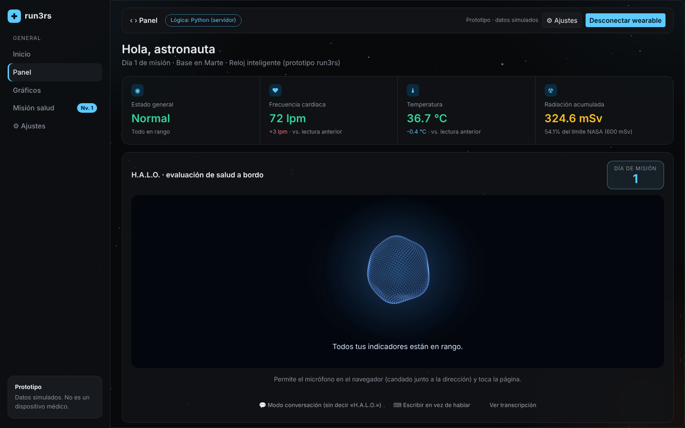
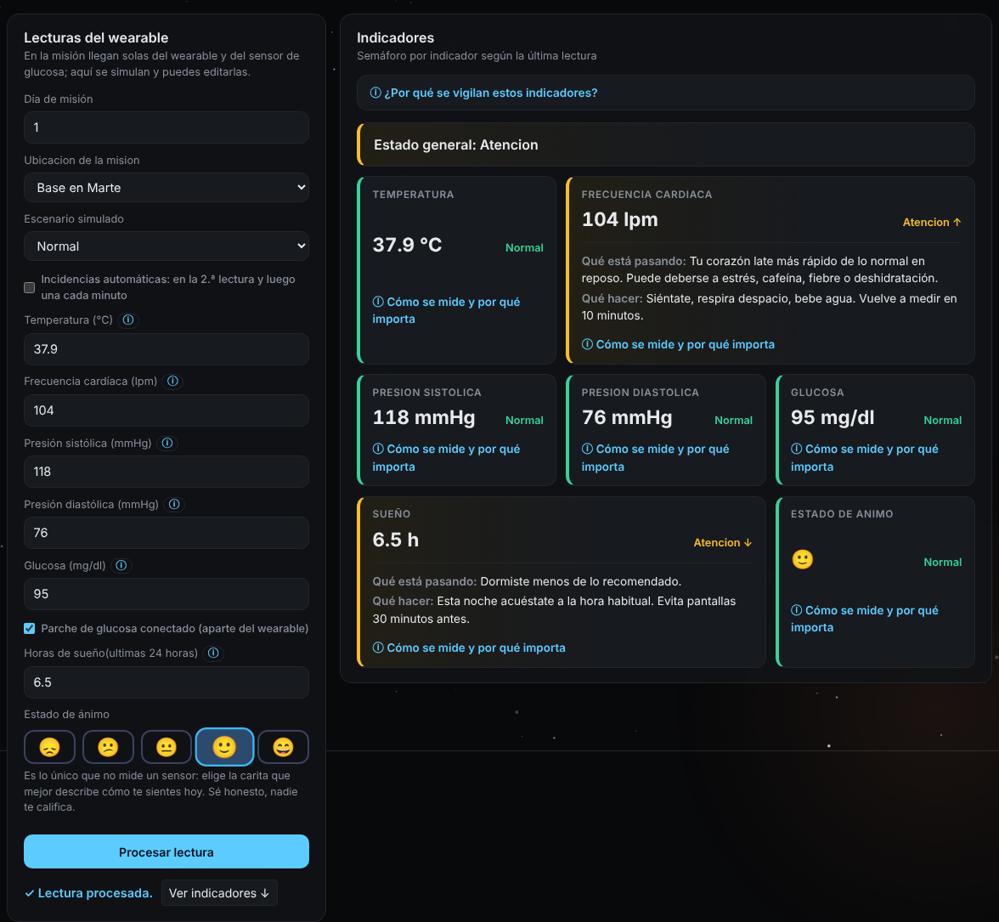
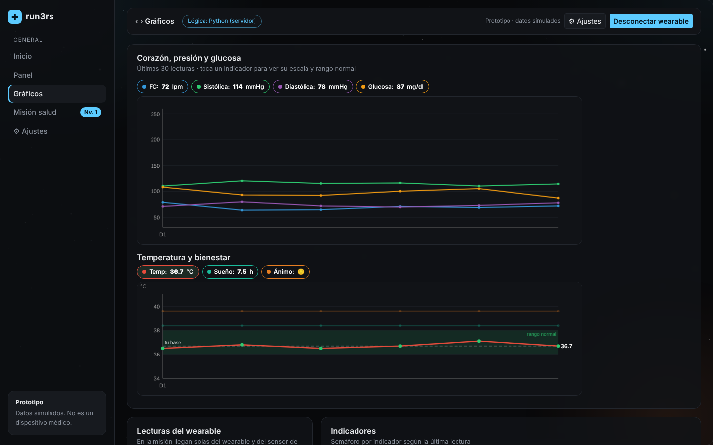
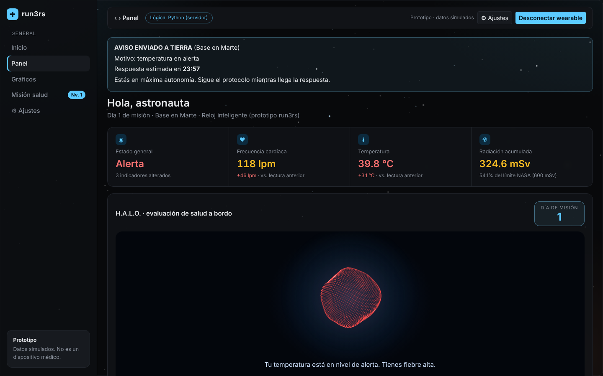
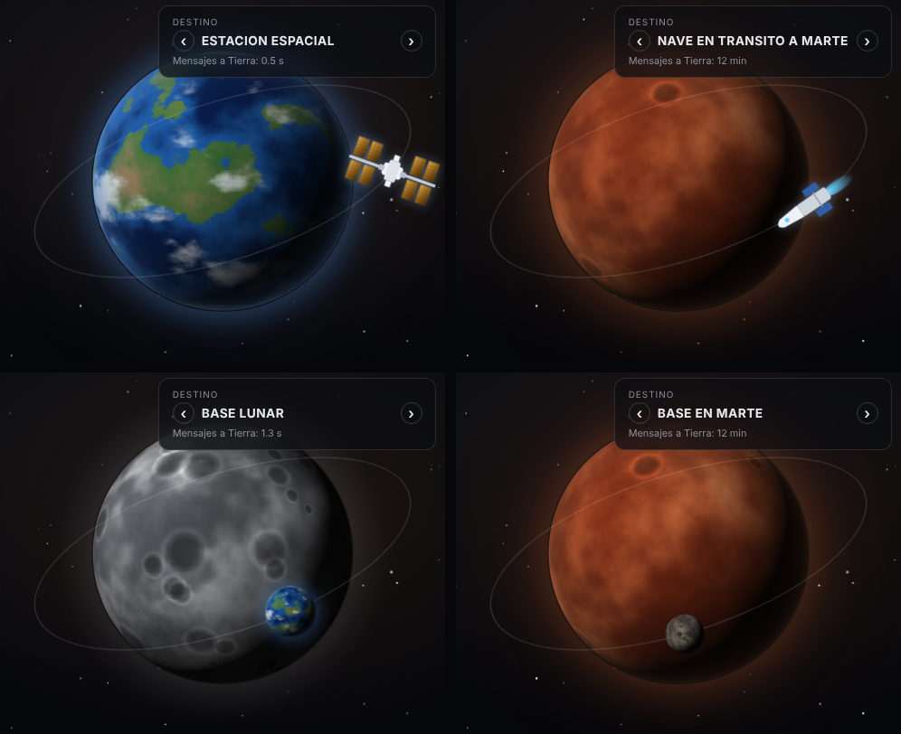
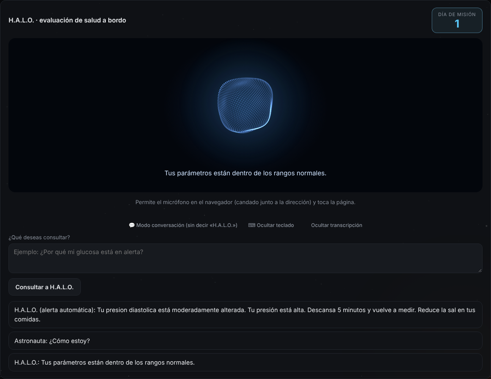
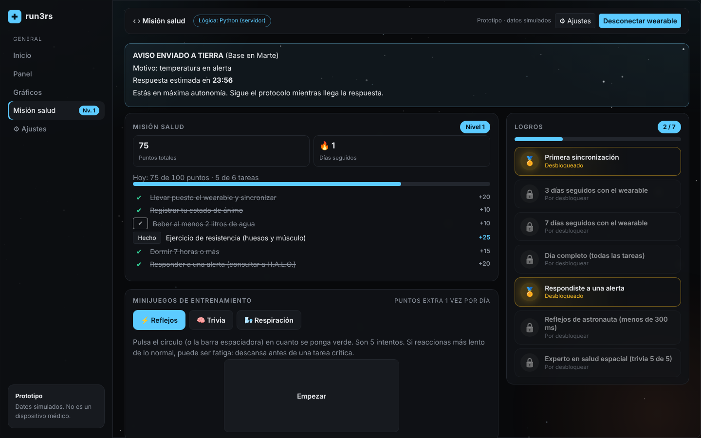

# H.A.L.O. — Health Assessment and Life-support Operations

[English](README.md) · **Español**

> Software de monitoreo de salud para astronautas en misiones de larga duración.
> **NASA Space Apps Challenge 2026 — Equipo REN3RS**



-🔗 **Demo en vivo:** (https://lasana00.vercel.app/)

-🎥 **Video de 30 segundos:** (https://drive.google.com/file/d/1XykPVtq1RWY58P0xgmo_GscTQLG0q8P_/view?usp=sharing)

-🏆 **Página del proyecto en NASA Space Apps:** (https://www.spaceappschallenge.org/2026/find-a-team/run3rs/?tab=project)

---

## El problema

Las misiones de larga duración exponen a los astronautas a la radiación espacial, al aislamiento y el confinamiento, a una gravedad alterada y a un entorno cerrado y hostil. Estas condiciones pueden provocar cambios en el sistema inmunitario, pérdida ósea, eventos cardiovasculares y problemas de salud conductual. Camino a Marte, la ayuda desde la Tierra puede tardar minutos u horas: los tripulantes cargan con gran parte de la responsabilidad de detectar estos cambios en sí mismos.

## La solución

H.A.L.O. es una aplicación web de monitoreo de salud que:

1. **Recibe los signos vitales de un wearable simulado**: un prototipo de reloj inteligente, la banda WHOOP MG o el Bio-Monitor de la Agencia Espacial Canadiense. Cada uno simula solo lo que mide en realidad (temperatura, frecuencia cardíaca, presión arterial, sueño); la glucosa llega de un parche opcional (CGM) y el ánimo lo registra el astronauta.
2. **Evalúa** cada lectura con umbrales de la NASA y clínicos, y devuelve un estado (verde / amarillo / rojo) y una dirección (alto / bajo).
3. **Explica en lenguaje sencillo** qué significa el valor y qué hacer: sin diagnósticos, con instrucciones que empiezan por un verbo y una guía de "cómo se mide y por qué importa" para cada indicador.
4. **Muestra gráficos dinámicos** de cómo cambia cada indicador con el tiempo, comparado con la línea base personal del astronauta.
5. **Se adapta al hábitat** (Estación Espacial, tránsito a Marte, base lunar, base en Marte): radiación acumulada, gravedad, pérdida ósea y retraso de las comunicaciones con la Tierra.
6. **Conversa con el astronauta** mediante el asistente de voz H.A.L.O. (Gemini): responde preguntas sobre sus signos vitales, explica las alertas, cuenta chistes y pregunta cómo se siente durante el aislamiento.
7. **Avisa a la Tierra** de inmediato ante cualquier indicador en rojo, o cuando un amarillo se repite en 3 lecturas seguidas, con el tiempo estimado de respuesta.
8. **Convierte los hábitos saludables en un juego** en *Misión salud*: tareas diarias, puntos, niveles, rachas, logros y tres minijuegos de entrenamiento (prueba de reflejos, trivia de salud espacial y respiración en caja).



---

## Capturas de pantalla

### Lecturas e indicadores con semáforo


### Gráficos dinámicos


### Alerta en rojo y aviso a la Tierra


### Selección del hábitat


### Asistente H.A.L.O.


### Misión salud (gamificación)


---

## Tecnologías

| Capa | Tecnología |
|---|---|
| Frontend | HTML / CSS / JavaScript sin framework + Bootstrap 5 |
| Lógica de salud | Función serverless en Python (`/api/evaluar`), con respaldo en JavaScript en el navegador |
| Asistente | Google Gemini mediante un proxy serverless en Python (`/api/nova`): la clave nunca llega al navegador |
| Voz | Texto a voz de Gemini (`/api/voz`) + Web Speech API para el reconocimiento; voz del navegador como respaldo |
| Hosting | Vercel |
| Estado | `localStorage` (prototipo de hackatón) |
| Idiomas | Español e inglés (`public/i18n.js`) |

## Estructura del repositorio

```
REN3RS/
├── public/
│   ├── index.html        # Entrada de la app
│   ├── app.js            # Lógica del cliente (interfaz, simulación, gráficos, voz, gamificación)
│   ├── i18n.js           # Traducciones al inglés
│   ├── style.css
│   └── vendor/           # Bootstrap
├── api/
│   ├── evaluar.py        # Semáforo y modelo de hábitats (Python)
│   ├── nova.py           # Asistente H.A.L.O.: proxy de Gemini + reglas locales
│   ├── voz.py            # Texto a voz de Gemini
│   └── asistente.js      # Respaldo antiguo del asistente
├── data/                 # Umbrales, parámetros de hábitats, wearables y fuentes
├── docs/
│   └── images/           # Capturas de este README (es/ = versión en español)
├── servidor_local.py     # Servidor local: sirve public/ y ejecuta api/*.py
├── README.md
└── README.es.md
```

## Ejecutar en local

```bash
git clone https://github.com/pip3-00/REN3RS.git
cd REN3RS
python servidor_local.py
# abre http://localhost:8000
```

`servidor_local.py` sirve la app y ejecuta la API en Python. También puedes abrir `public/index.html` directamente (o con Live Server), pero entonces la evaluación usa el respaldo en JavaScript y el asistente solo responde con sus reglas locales.

Para publicar en Vercel:

```bash
npm i -g vercel
vercel
```

Variables de entorno:

- `GEMINI_API_KEY` — clave de la API de Google Gemini que usan el asistente y la voz.
- `HALO_VOZ` *(opcional)* — nombre de la voz de Gemini (por defecto `Charon`).

---

## Cómo funciona

### Evaluación de indicadores

Cada lectura se evalúa con `evaluar_indicador(clave, valor)` en `api/evaluar.py`, que devuelve:

```python
{"estado": "amarillo", "direccion": "alto"}   # estado: verde | amarillo | rojo | sin-dato
                                              # direccion: alto | bajo | None
```

Los mensajes se buscan por `estado + direccion`, así la app puede decir *"tu temperatura está un poco alta"* en lugar de solo *"amarillo"*. Los umbrales están en [`data/umbrales.json`](data/umbrales.json).

### Regla del aviso a la Tierra

- **Rojo** en cualquier indicador → aviso a la Tierra inmediato.
- **Amarillo** → aviso solo si se repite en **3 lecturas seguidas** (3 días seguidos en los indicadores diarios, como el sueño).

### Modelo de hábitats

| Hábitat | Gravedad | Retraso (un sentido) | Radiación |
|---|---|---|---|
| Estación Espacial | microgravedad | ~0.5 s | 0.2–0.5 mSv/día (0.35 en el modelo) |
| Tránsito a Marte | microgravedad | 3–22 min | 1.8 mSv/día (Curiosity RAD) |
| Base lunar | ~1/6 g | ~1.3 s | 0.35 mSv/día (modelo) |
| Base en Marte | ~1/3 g | 3–22 min | 0.64 mSv/día (Curiosity RAD) |

Los protocolos de alerta en rojo incluyen una línea según el hábitat (por ejemplo, en Marte: *"Estás en máxima autonomía. Sigue el protocolo mientras llega la respuesta"*). Los parámetros están en [`data/habitats.json`](data/habitats.json).

---

## Datos de la NASA y referencias

- **NASA OCHMO — Design for Ionizing Radiation Protection (NASA-STD-3001)** — límite de dosis de carrera (<600 mSv) y de eventos solares (<250 mSv). [PDF](https://www.nasa.gov/wp-content/uploads/2023/03/radiation-protection-technical-brief-ochmo.pdf)
- **Simonsen, Zawaski y Weeks (NASA HQ / JSC) — Moon 2 Mars Space Radiation Protection** — dosis en la Estación Espacial. [NTRS](https://ntrs.nasa.gov/api/citations/20250006168/downloads/ASCEND%20Simonsen%20draft%201.pdf)
- **Curiosity RAD en tránsito — Zeitlin et al. 2013, *Science*** — 1.8 mSv/día en crucero. [Comunicado de SwRI](https://www.swri.org/newsroom/press-releases/swri-led-team-calculates-radiation-exposure-associated-trip-mars)
- **Curiosity RAD en la superficie de Marte — Hassler et al. 2014, *Science* 343** — ~0.64 mSv/día. [NTRS 20180007641](https://ntrs.nasa.gov/citations/20180007641)
- **NASA HRP — Hazard: Gravity Fields** — pérdida ósea y efectos ortostáticos tras el aterrizaje. [Enlace](https://www.nasa.gov/hrp/hazard-gravity-fields)
- **NASA HRP — Risk of Spaceflight-Induced Bone Changes.** [Enlace](https://www.nasa.gov/reference/risk-of-spaceflight-induced-bone-changes/)
- **Sibonga et al. (NASA, 2017) — Risk of Early Onset Osteoporosis Due to Spaceflight.** [NTRS 20170004598](https://ntrs.nasa.gov/citations/20170004598)
- **ADA — Standards of Care in Diabetes 2024, §6.12** — protocolo de hipoglucemia (regla de 15 g / 15 min).
- **AHA** — frecuencia cardíaca en reposo y medición de la presión arterial en casa.
- **MedlinePlus** — medición de la temperatura corporal; criterios de hipotensión.
- **CDC** — horas de sueño recomendadas en adultos.
- **CORDIS — ARTHEROSPACE** — desacondicionamiento cardiovascular al volver a la gravedad.
- **Bio-Monitor de la Agencia Espacial Canadiense (Astroskin, Carré Technologies), WHOOP MG y Apple Watch Series 11** — referencias para los wearables simulados.

Lista completa: [`data/fuentes.md`](data/fuentes.md).

---

## Uso de inteligencia artificial

- **En el producto.** H.A.L.O. integra un asistente de Google Gemini al que se llama mediante una función serverless de Vercel, así la clave de la API nunca llega al navegador. El asistente relaciona los signos vitales actuales con el contexto del hábitat; nunca diagnostica: todos los umbrales clínicos salen de las fuentes de arriba, no del modelo. Sin conexión, responde con reglas locales.
- **En el desarrollo.** Durante las 48 horas del hackatón se usó Claude (Anthropic) como asistente de programación e investigación. Todos los umbrales, las fuentes y los mensajes clínicos que ve el usuario se verificaron con los documentos originales de la NASA, la ADA, la AHA, los CDC y MedlinePlus antes de incluirlos.

---

## Equipo REN3RS

- **Daphne**
- **Manuel**
- **Ronald**
<!-- Agrega aquí a los demás miembros del equipo -->

**Evento local:** NASA Space Apps Santo Domingo — INTEC, 14 y 15 de noviembre de 2026.

## Aviso

Esta herramienta orienta; no reemplaza el criterio del médico de vuelo. Prototipo construido durante un hackatón de 48 horas.
