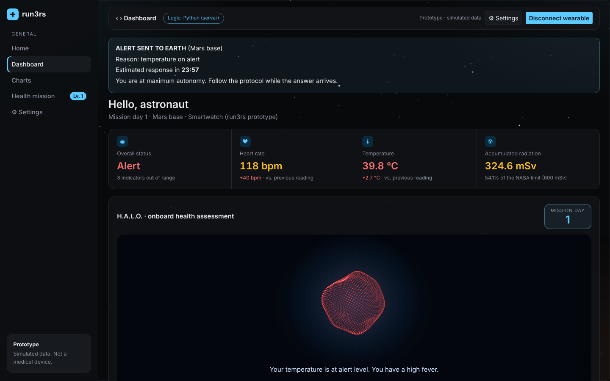
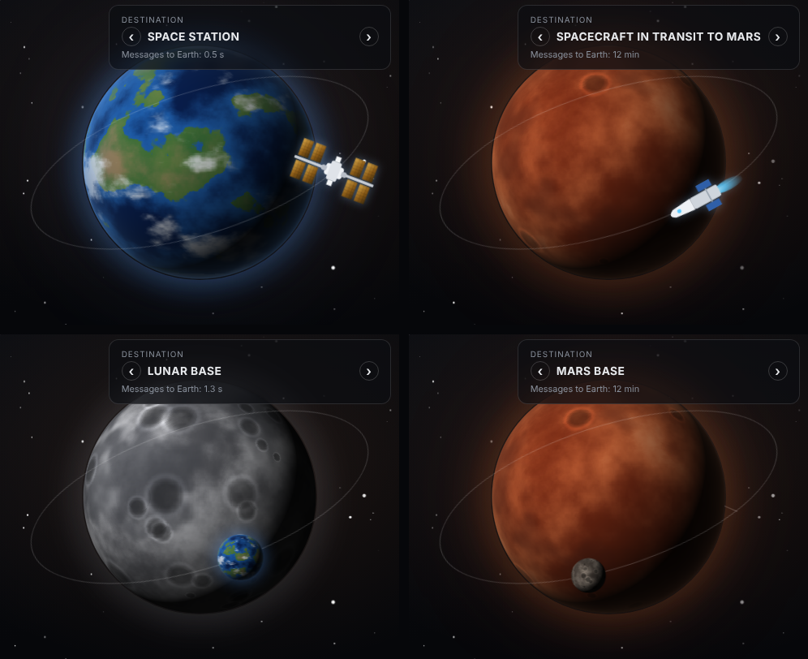
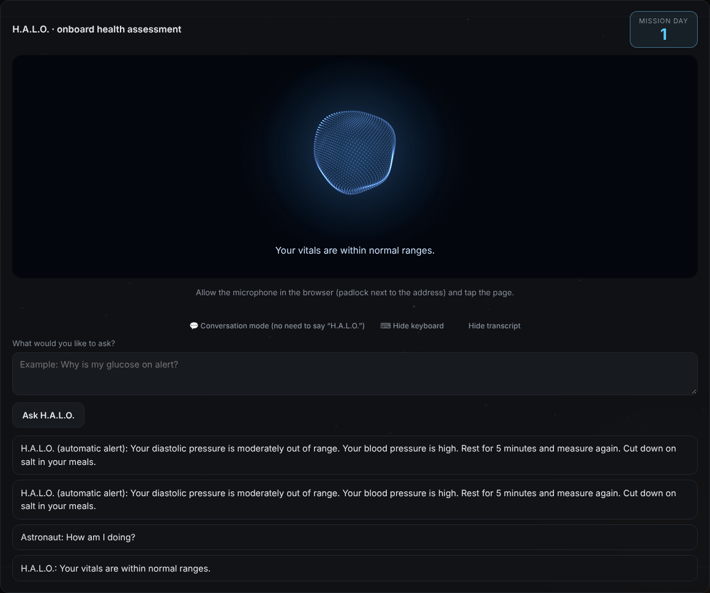

# H.A.L.O. — Health Assessment and Life-support Operations

> Astronaut health monitoring software for long-duration missions.
> **NASA Space Apps Challenge 2026 — Team REN3RS**


<!-- Replace docs/images/hero.png with your banner image -->

🔗 **Live demo:** (https://lasana00.vercel.app/)
🎥 **30-second demo video:** (https://drive.google.com/file/d/1XykPVtq1RWY58P0xgmo_GscTQLG0q8P_/view?usp=sharing)
🏆 **NASA Space Apps project page:** (https://www.spaceappschallenge.org/2026/find-a-team/run3rs/?tab=project)

---

## The Problem

Long-duration missions expose astronauts to space radiation, isolation and confinement, altered gravity, and a hostile closed environment. These conditions can trigger immune changes, bone loss, cardiovascular events, and behavioral health problems. On the way to Mars, Earth support can be minutes or hours away — crew members carry most of the responsibility for spotting these changes in themselves.

## The Solution

H.A.L.O. is a browser-based health monitoring app that:

1. **Ingests vitals** from a simulated Astroskin-style wearable (temperature, heart rate, blood pressure, glucose, sleep, mood).
2. **Evaluates** each reading against NASA / clinical thresholds and returns a state (green / yellow / red) plus a direction (high / low).
3. **Explains in plain language** what the value means and what to do next — no diagnosis, verb-first instructions.
4. **Adapts to the habitat** (ISS, Mars transit, Moon base, Mars base) — radiation accumulation, gravity, and Earth communication delay.
5. **Integrates an AI assistant** (H.A.L.O. voice) that correlates vitals with habitat context.
6. **Alerts Earth** on red states with the expected round-trip delay.


<!-- Screenshot of the main vitals dashboard -->

---

## Screenshots

### Vitals input

<!-- Screenshot of the measurement input flow -->

### Alert state + Earth transmission

<!-- Screenshot of a red-state alert with the Earth notification -->

### Habitat selection

<!-- Screenshot of the habitat picker (ISS / transit / Moon / Mars) -->

### H.A.L.O. assistant

<!-- Screenshot of the AI assistant briefing -->

---

## Tech Stack

| Layer | Technology |
|---|---|
| Frontend | Vanilla HTML / CSS / JavaScript (no framework) |
| Hosting | Vercel |
| Serverless API proxy | Vercel Functions (`/api/asistente`) |
| AI assistant | LLM via server-side proxy (API key kept off the client) |
| State | `localStorage` (hackathon prototype) |
| Repository layout | `public/` (app.js, index.html, style.css) · `api/` (serverless proxy) · `data/` · `docs/` |

## Repository Structure

```
REN3RS/
├── public/
│   ├── index.html        # App entry
│   ├── app.js            # Client logic (evaluation, UI, storage)
│   └── style.css
├── api/
│   └── asistente.mjs     # Serverless proxy for the AI assistant
├── data/                 # Thresholds, habitat parameters, sources
├── docs/
│   └── images/           # Screenshots for this README
├── README.md
└── .gitignore
```

## Run Locally

```bash
git clone https://github.com/pip3-00/REN3RS.git
cd REN3RS
# Static app — open public/index.html directly, or serve it:
npx serve public
```

For the AI assistant (serverless proxy), deploy to Vercel:

```bash
npm i -g vercel
vercel
```

Set the following environment variable in your Vercel project:

- `AI_API_KEY` — API key for the LLM provider used by the assistant.

---

## How It Works

### Indicator evaluation

Every reading is evaluated by `evaluarIndicador(value, indicator)` and returns:

```js
{ state: 'yellow', direction: 'high' }   // state: green | yellow | red
                                          // direction: high | low | null
```

Messages are looked up by `state + direction`, so the app can say *"your temperature is a little high"* rather than just *"yellow."*

### Habitat model

| Habitat | Gravity | One-way delay | Radiation rate |
|---|---|---|---|
| ISS | microgravity | ~0.5 s | 0.2–0.5 mSv/day |
| Mars transit | microgravity | 3–22 min | 1.8 mSv/day (Curiosity RAD) |
| Moon base | ~1/6 g | ~1.3 s | — |
| Mars base | ~1/3 g | 3–22 min | 0.64 mSv/day (Curiosity RAD) |

Red-state protocols include a habitat-specific line (e.g., *"You are in maximum autonomy. Follow the protocol while the response arrives"* for Mars).

---

## NASA Data & References

- **NASA OCHMO — Design for Ionizing Radiation Protection (NASA-STD-3001)** — career dose limit (<600 mSv), SPE limit (<250 mSv). [PDF](https://www.nasa.gov/wp-content/uploads/2023/03/radiation-protection-technical-brief-ochmo.pdf)
- **Simonsen, Zawaski & Weeks (NASA HQ / JSC) — Moon 2 Mars Space Radiation Protection** — ISS dose rate. [NTRS](https://ntrs.nasa.gov/api/citations/20250006168/downloads/ASCEND%20Simonsen%20draft%201.pdf)
- **Curiosity RAD in transit — Zeitlin et al. 2013, *Science*** — 1.8 mSv/day in cruise. [SwRI release](https://www.swri.org/newsroom/press-releases/swri-led-team-calculates-radiation-exposure-associated-trip-mars)
- **Curiosity RAD on Mars surface — Hassler et al. 2014, *Science* 343** — ~0.64 mSv/day. [NTRS 20180007641](https://ntrs.nasa.gov/citations/20180007641)
- **NASA HRP — Hazard: Gravity Fields** — bone loss and post-landing orthostatic effects. [Link](https://www.nasa.gov/hrp/hazard-gravity-fields)
- **NASA HRP — Risk of Spaceflight-Induced Bone Changes.** [Link](https://www.nasa.gov/reference/risk-of-spaceflight-induced-bone-changes/)
- **Sibonga et al. (NASA, 2017) — Risk of Early Onset Osteoporosis Due to Spaceflight.** [NTRS 20170004598](https://ntrs.nasa.gov/citations/20170004598)
- **ADA — Standards of Care in Diabetes 2024, §6.12** — hypoglycemia protocol (15 g / 15 min rule).
- **AHA** — resting heart rate and home blood pressure measurement protocols.
- **MedlinePlus** — body temperature measurement; hypotension criteria.
- **CDC** — adult sleep duration recommendations.
- **CORDIS — ARTHEROSPACE** — cardiovascular deconditioning on return to gravity.
- **Astroskin (Hexoskin / Carré Technologies)** — reference for the simulated wearable.

---

## Use of Artificial Intelligence

- **In the product.** H.A.L.O. integrates an LLM-powered assistant, called through a Vercel serverless function so the API key never ships to the client. The assistant correlates current vitals with habitat context; it never diagnoses — all clinical thresholds come from the sources above, not from the model.
- **In development.** Claude (Anthropic) was used during the 48-hour hackathon as a pair-programming and research assistant. All thresholds, sources, and user-facing clinical messages were verified against the original NASA / ADA / AHA / CDC / MedlinePlus documents before inclusion.

---

## Team REN3RS

- **Daphne** — Software development, game/evaluation logic, integration.
<!-- Add other team members here -->

**Local event:** NASA Space Apps Santo Domingo — INTEC, Nov 14–15, 2026.


## Disclaimer

This tool orients; it does not replace flight surgeon judgment. Prototype built during a 48-hour hackathon.
