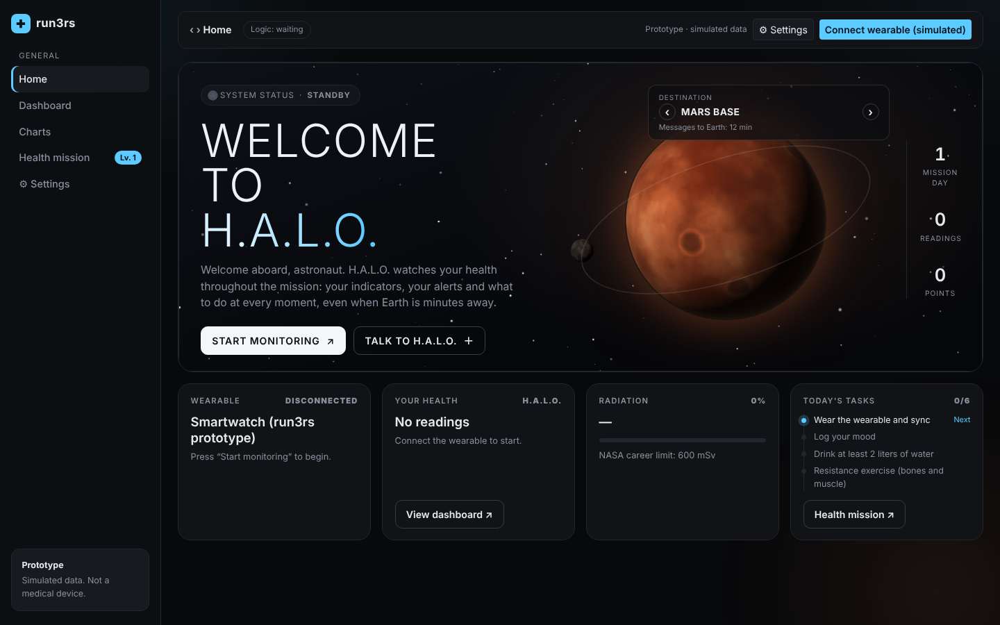
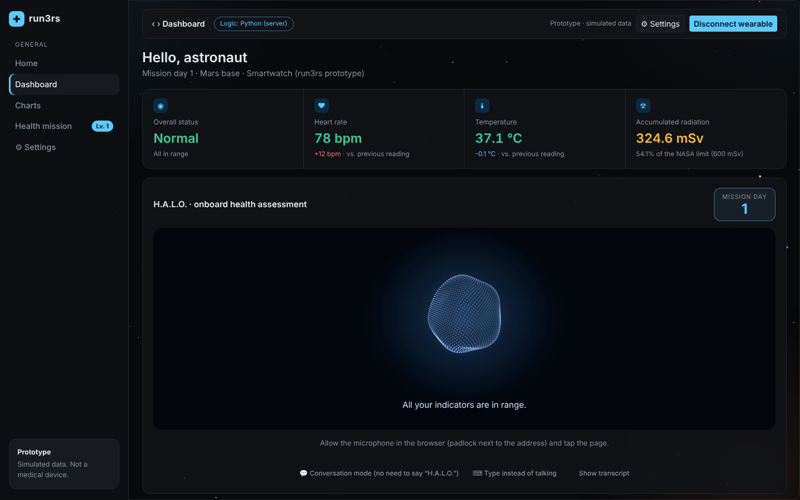
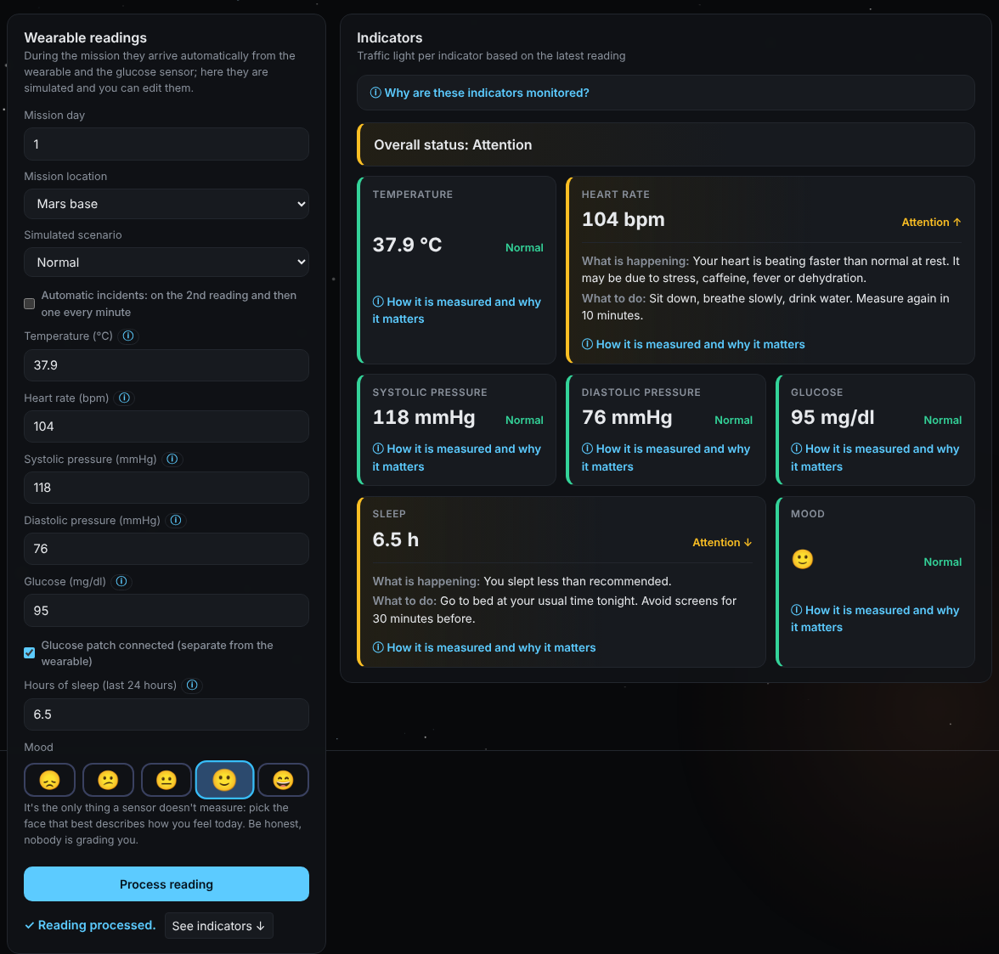
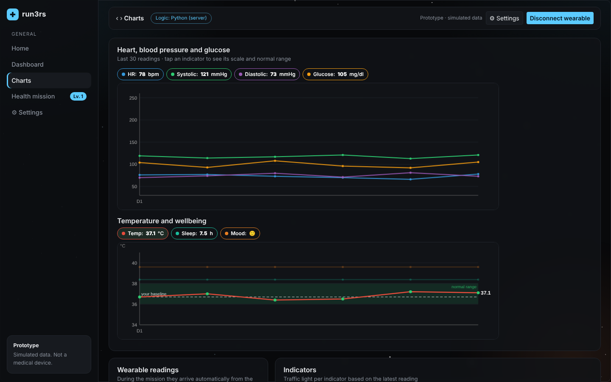
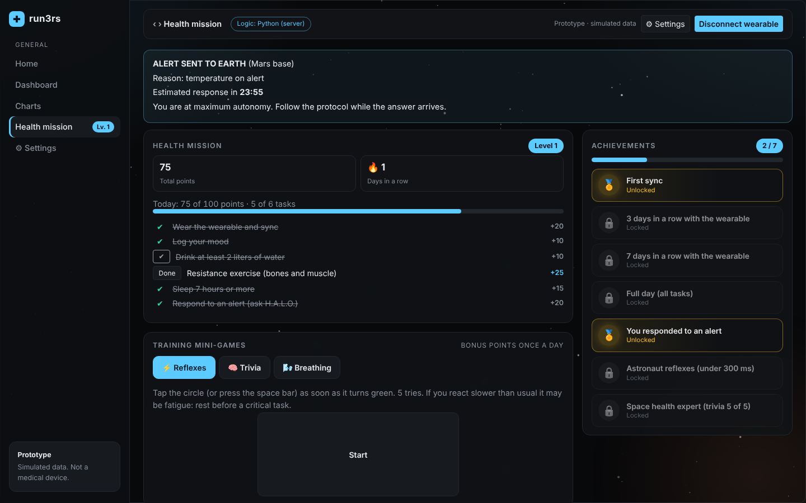

# H.A.L.O. — Health Assessment and Life-support Operations

**English** · [Español](README.es.md)

> Astronaut health monitoring software for long-duration missions.
> **NASA Space Apps Challenge 2026 — Team REN3RS**



-🔗 **Live demo:** (https://lasana00.vercel.app/)
-🎥 **30-second demo video:** (https://drive.google.com/file/d/1XykPVtq1RWY58P0xgmo_GscTQLG0q8P_/view?usp=sharing)
-🏆 **NASA Space Apps project page:** (https://www.spaceappschallenge.org/2026/find-a-team/run3rs/?tab=project)

---

## The Problem

Long-duration missions expose astronauts to space radiation, isolation and confinement, altered gravity, and a hostile closed environment. These conditions can trigger immune changes, bone loss, cardiovascular events, and behavioral health problems. On the way to Mars, Earth support can be minutes or hours away — crew members carry most of the responsibility for spotting these changes in themselves.

## The Solution

H.A.L.O. is a browser-based health monitoring app that:

1. **Ingests vitals from a simulated wearable** — a smartwatch prototype, a WHOOP MG band or the Canadian Space Agency Bio-Monitor. Each one simulates only what it really measures (temperature, heart rate, blood pressure, sleep); glucose comes from an optional CGM patch and mood is self-reported.
2. **Evaluates** each reading against NASA / clinical thresholds and returns a state (green / yellow / red) plus a direction (high / low).
3. **Explains in plain language** what the value means and what to do next — no diagnosis, verb-first instructions, and a "how it is measured and why it matters" guide for every indicator.
4. **Shows dynamic charts** of how each indicator changes over time, against the astronaut's personal baseline.
5. **Adapts to the habitat** (ISS, Mars transit, Moon base, Mars base) — radiation accumulation, gravity, bone loss, and Earth communication delay.
6. **Talks with the astronaut** through the H.A.L.O. voice assistant (Gemini): answers questions about their vitals, explains alerts, tells jokes and checks in on how they feel during isolation.
7. **Alerts Earth** immediately on any red indicator, or when a yellow indicator repeats in 3 consecutive readings, with the expected response delay.
8. **Gamifies healthy habits** in *Health mission*: daily tasks, points, levels, streaks, achievements, and three training mini-games (reaction test, space-health trivia, box breathing).



---

## Screenshots

### Vitals input and traffic-light indicators


### Dynamic charts


### Alert state + Earth transmission


### Habitat selection


### H.A.L.O. assistant


### Health mission (gamification)


---

## Tech Stack

| Layer | Technology |
|---|---|
| Frontend | Vanilla HTML / CSS / JavaScript + Bootstrap 5 (no framework) |
| Health logic | Python serverless function (`/api/evaluar`), with a JavaScript fallback in the browser |
| AI assistant | Google Gemini through a Python serverless proxy (`/api/nova`) — the API key never reaches the client |
| Voice | Gemini text-to-speech (`/api/voz`) + Web Speech API for recognition; browser voice as fallback |
| Hosting | Vercel |
| State | `localStorage` (hackathon prototype) |
| Languages | Spanish and English (`public/i18n.js`) |

## Repository Structure

```
REN3RS/
├── public/
│   ├── index.html        # App entry
│   ├── app.js            # Client logic (UI, simulation, charts, voice, gamification)
│   ├── i18n.js           # English translations
│   ├── style.css
│   └── vendor/           # Bootstrap
├── api/
│   ├── evaluar.py        # Traffic-light evaluation and habitat model (Python)
│   ├── nova.py           # H.A.L.O. assistant: Gemini proxy + local rules
│   ├── voz.py            # Gemini text-to-speech
│   └── asistente.js      # Legacy fallback for the assistant
├── data/                 # Thresholds, habitat parameters, wearables and sources
├── docs/
│   └── images/           # Screenshots for this README (es/ = Spanish version)
├── servidor_local.py     # Local server: serves public/ and runs api/*.py
├── README.md
└── README.es.md
```

## Run Locally

```bash
git clone https://github.com/pip3-00/REN3RS.git
cd REN3RS
python servidor_local.py
# open http://localhost:8000
```

`servidor_local.py` serves the app and runs the Python API. Opening `public/index.html` directly (or with Live Server) works too, but the evaluation falls back to JavaScript and the assistant uses its local rules only.

To deploy to Vercel:

```bash
npm i -g vercel
vercel
```

Environment variables:

- `GEMINI_API_KEY` — Google Gemini API key used by the assistant and the voice.
- `HALO_VOZ` *(optional)* — Gemini voice name (default `Charon`).

---

## How It Works

### Indicator evaluation

Every reading is evaluated by `evaluar_indicador(clave, valor)` in `api/evaluar.py` and returns:

```python
{"estado": "amarillo", "direccion": "alto"}   # estado: verde | amarillo | rojo | sin-dato
                                              # direccion: alto | bajo | None
```

Messages are looked up by `estado + direccion`, so the app can say *"your temperature is a little high"* rather than just *"yellow."* The thresholds are in [`data/umbrales.json`](data/umbrales.json).

### Earth notification rule

- **Red** in any indicator → notify Earth immediately.
- **Yellow** → notify Earth only if it repeats in **3 consecutive readings** (3 consecutive days for daily indicators such as sleep).

### Habitat model

| Habitat | Gravity | One-way delay | Radiation rate |
|---|---|---|---|
| ISS | microgravity | ~0.5 s | 0.2–0.5 mSv/day (0.35 in the model) |
| Mars transit | microgravity | 3–22 min | 1.8 mSv/day (Curiosity RAD) |
| Moon base | ~1/6 g | ~1.3 s | 0.35 mSv/day (model) |
| Mars base | ~1/3 g | 3–22 min | 0.64 mSv/day (Curiosity RAD) |

Red-state protocols include a habitat-specific line (e.g., *"You are in maximum autonomy. Follow the protocol while the response arrives"* for Mars). Parameters are in [`data/habitats.json`](data/habitats.json).

---

## NASA Data & References

- **NASA OCHMO — Design for Ionizing Radiation Protection (NASA-STD-3001)** — career dose limit (<600 mSv), SPE limit (<250 mSv). [PDF](https://www.nasa.gov/wp-content/uploads/2023/03/radiation-protection-technical-brief-ochmo.pdf)
- **Simonsen, Zawaski & Weeks (NASA HQ / JSC) — Moon 2 Mars Space Radiation Protection** — ISS dose rate. [NTRS](https://ntrs.nasa.gov/api/citations/20250006168/downloads/ASCEND%20Simonsen%20draft%201.pdf)
- **Curiosity RAD in transit — Zeitlin et al. 2013, *Science*** — 1.8 mSv/day in cruise. [SwRI release](https://www.swri.org/newsroom/press-releases/swri-led-team-calculates-radiation-exposure-associated-trip-mars)
- **Curiosity RAD on Mars surface — Hassler et al. 2014, *Science* 343** — ~0.64 mSv/day. [NTRS 20180007641](https://ntrs.nasa.gov/citations/20180007641)
- **NASA HRP — Hazard: Gravity Fields** — bone loss and post-landing orthostatic effects. [Link](https://www.nasa.gov/hrp/hazard-gravity-fields)
- **NASA HRP — Risk of Spaceflight-Induced Bone Changes.** [Link](https://www.nasa.gov/reference/risk-of-spaceflight-induced-bone-changes/)
- **Sibonga et al. (NASA, 2017) — Risk of Early Onset Osteoporosis Due to Spaceflight.** [NTRS 20170004598](https://ntrs.nasa.gov/citations/20170004598)
- **ADA — Standards of Care in Diabetes 2024, §6.12** — hypoglycemia protocol (15 g / 15 min rule).
- **AHA** — resting heart rate and home blood pressure measurement protocols.
- **MedlinePlus** — body temperature measurement; hypotension criteria.
- **CDC** — adult sleep duration recommendations.
- **CORDIS — ARTHEROSPACE** — cardiovascular deconditioning on return to gravity.
- **Canadian Space Agency Bio-Monitor (Astroskin, Carré Technologies), WHOOP MG and Apple Watch Series 11** — references for the simulated wearables.

Full list: [`data/fuentes.md`](data/fuentes.md).

---

## Use of Artificial Intelligence

- **In the product.** H.A.L.O. integrates a Google Gemini assistant, called through a Vercel serverless function so the API key never ships to the client. The assistant correlates current vitals with habitat context; it never diagnoses — all clinical thresholds come from the sources above, not from the model. Without a connection it answers with local rules.
- **In development.** Claude (Anthropic) was used during the 48-hour hackathon as a pair-programming and research assistant. All thresholds, sources, and user-facing clinical messages were verified against the original NASA / ADA / AHA / CDC / MedlinePlus documents before inclusion.

---

## Team REN3RS

- **Daphne** (me)
- **Manuel**
- **Ronald**
<!-- Add other team members here -->

**Local event:** NASA Space Apps Santo Domingo — INTEC, Nov 14–15, 2026.

## Disclaimer

This tool orients; it does not replace flight surgeon judgment. Prototype built during a 48-hour hackathon.
